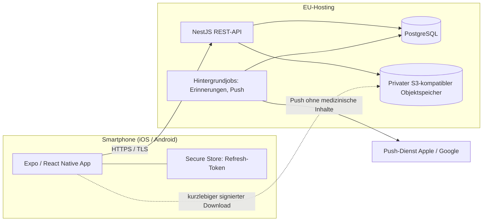

# Architektur

Status: Entwurf (Phase 1). Nichts davon ist umgesetzt.
Versionsnummern, Preise und Anbieterfunktionen sind bewusst **nicht** festgeschrieben und müssen vor der Umsetzung gegen die aktuelle Dokumentation geprüft werden.

## 1. Ziele und Randbedingungen

- Zwei Nutzer, später erweiterbar. Eine betreute Person, Datenmodell aber mandantenfähig.
- Gesundheitsdaten: sensibel behandeln, ohne Klinik-Aufwand.
- Kleines Team (privat), daher wenig Betriebsaufwand und wenige bewegliche Teile.
- Kein serverseitiger E-Mail-Versand im ersten Schritt.

## 2. Systemübersicht

## 3. Entscheidungen

### E1 – Mobile App: React Native mit Expo und TypeScript
Eine Codebasis für iOS und Android, passend zum Vorgabestack. Sitzungstoken liegen im Secure Store des Betriebssystems.
Offene Prüfung: aktuelle Expo-SDK-Version und Kompatibilität der verwendeten Bibliotheken.

### E2 – Backend: eigenes NestJS statt Supabase (Empfehlung)
| Kriterium | Eigenes NestJS + PostgreSQL | Supabase |
|---|---|---|
| Berechtigungslogik | Zentral im Code, gut testbar | Row-Level-Security-Policies, mächtig, aber fehleranfällig |
| Datenstandort | Frei wählbar | Region wählbar, zu prüfen |
| Betrieb | Mehr Eigenaufwand | Weniger Eigenaufwand |
| Austauschbarkeit | Hoch | Teilweise gebunden |

Empfehlung: NestJS. Die Berechtigungsregeln (Familie, Betreuungskontext, Rollen) bleiben an einer Stelle prüfbar und lassen sich mit Integrationstests absichern. Supabase bleibt eine ernsthafte Alternative, falls Betriebsaufwand wichtiger ist als Kontrolle. Dann wäre RLS vollständig zu testen.
Status: **offene Entscheidung, bitte bestätigen.** Der begonnene Code folgt der NestJS-Variante.
Versionshinweis: NestJS 12 ist reines ESM und lief in dieser Umgebung nicht mit Jest/ts-jest. Verwendet wird daher **NestJS 11** (CommonJS) mit TypeScript 5.9. Ein Upgrade ist später als eigenes Arbeitspaket möglich.

### E3 – Datenbank und Migrationen (umgesetzt)
PostgreSQL mit dem Treiber `pg` und handgeschriebenen, versionierten SQL-Migrationen (`apps/api/src/db/migrations`, Runner mit Tabelle `schema_migrations`, jede Migration in einer Transaktion). Keine manuellen Schemaänderungen.
Begründung: Prisma lädt beim Einrichten Binärdateien von einem Server, der in der Entwicklungsumgebung nicht erreichbar war; reines SQL ist zudem für Trigger (append-only-Protokoll) und Constraints direkt ausdrückbar. Ein ORM kann später ergänzt werden.

### E4 – Authentifizierung
- E-Mail und Passwort, Hashing mit Argon2id.
- Kurzlebiges Access-Token, Refresh-Token in der Datenbank (rotierend, einzeln widerrufbar). Dadurch beendet ein Entzug von Zugriffen Sitzungen wirksam.
- Optional TOTP-Zwei-Faktor, zunächst für Administratoren empfohlen.
- Einladung per Link mit Ablaufzeit und Einmalcode.

### E5 – Dateien
- Privater Bucket, keine öffentlichen URLs.
- Upload über die API (Prüfung von Dateityp anhand der Inhalte, Größe, Name). Download nur nach Berechtigungsprüfung über kurzlebige signierte URLs oder durch die API gestreamt.
- Erlaubt: PDF, JPEG, PNG, HEIC. Größenlimit festlegen (Vorschlag: 20 MB).
- Versionierung: neue Datei = neue `document_version`, nie überschreiben.
- Malware-Scan: im ersten Schritt nicht vorgesehen, als spätere Erweiterung dokumentiert.

### E6 – E-Mail im ersten Schritt
Kein Versand durch den Server. Die App erzeugt Entwürfe (Empfänger, Betreff, Text mit Platzhaltern). Nutzer kopieren den Text oder öffnen ihn im Mail-Programm. Der Status (Entwurf, kopiert/geöffnet, als gesendet markiert, Antwort erhalten) wird manuell gepflegt. Die App behauptet nie, eine Mail sei gesendet oder zugestellt worden.
Spätere Option: serverseitiger Versand über einen EU-Anbieter oder SMTP, dann mit Freigabeprotokoll und Doppelversand-Schutz.

### E7 – Hintergrundjobs und Push
Erinnerungen laufen über einen geplanten Job im Backend (Warteschlange erst bei Bedarf). Push-Texte sind neutral („Aufgabe fällig“), ohne Namen, Diagnosen oder Medikamente.

### E8 – Hosting (Anbieter noch offen)
Anforderungen: Rechenzentrum in Deutschland oder EU, Auftragsverarbeitungsvertrag verfügbar, verschlüsselte Datenträger, automatische Backups, S3-kompatibler Objektspeicher.
Kandidaten zur Prüfung (keine Festlegung): Hetzner, IONOS, Scaleway, OVHcloud.
Zu prüfen pro Kandidat: Standort von Datenbank und Objektspeicher, AVV, Backup-Optionen, Kosten, Verschlüsselung im Ruhezustand, Möglichkeit zur Datenlöschung.
Status: **offen**, Ergebnis wird hier dokumentiert.

### E9 – Repository und Werkzeuge
Monorepo mit npm-Workspaces: `apps/mobile`, `apps/api`, `packages/shared` (Zod-Schemas, gemeinsame Typen). Validierung auf Client und Server mit denselben Schemas, Autorisierung nur serverseitig.

### E10 – Tests
- Unit: Jest (Reisezeitraum, Medikamentenbedarf, Platzhalter, Berechtigungen, Erinnerungen).
- Integration API: Jest und Supertest gegen eine echte PostgreSQL-Instanz in einem Container.
- Sicherheitstests: Zugriff auf fremde Familien, manipulierte IDs, Dateizugriff ohne Recht.
- Mobile End-to-End: ein Werkzeug wie Maestro oder Detox, Auswahl in Phase 2.

## 4. Schichtung im Backend

`Controller` (HTTP, Validierung) → `Guard` (Anmeldung, Mitgliedschaft, Rolle) → `Service` (Geschäftslogik) → `Repository` (Datenzugriff). Jede Abfrage auf Fachdaten ist über `care_recipient_id` an den Betreuungskontext gebunden, siehe `docs/security.md`.

## 5. Umgebungen

`development` (lokal, Docker), `test` (CI), `production`. Secrets nur über Umgebungsvariablen bzw. Secret-Store, nie im Repository oder in der App.

## 6. Bekannte Einschränkungen

- Kein Offline-Modus für Dokumente. Optional später: Zwischenspeicherung unkritischer Organisationsdaten.
- Keine OCR, keine automatische Diagnoseerkennung.
- Keine Malware-Prüfung in der ersten Version.
- Kein serverseitiger E-Mail-Versand in der ersten Version.
