# Datenmodell

Status: Entwurf. Migrationen entstehen in Phase 2 und folgen diesem Dokument.

## Grundregeln

- Primärschlüssel: UUID. Alle Tabellen mit `created_at`, `updated_at`; Fachdaten zusätzlich `created_by`, `updated_by`.
- **Jede Fachtabelle trägt `care_recipient_id`** (direkt oder über einen Elterndatensatz). Darüber wird die Berechtigung serverseitig geprüft.
- Dokumente und medizinische Einträge werden nicht überschrieben: neue Datei = neue `document_versions`-Zeile, Diagnoseänderungen erzeugen Aktivitätsereignisse mit Vorher/Nachher.
- Medizinische Angaben (`diagnoses`, `medications`) und organisatorische Notizen (`notes`-Felder) sind getrennte Felder.
- `activity_events` ist append-only (Update/Delete per Datenbank-Trigger gesperrt).
- Löschen: Fachdaten per Soft-Delete (`deleted_at`), endgültiges Löschen nur durch Administratoren und protokolliert.
- Abweichung von der ursprünglichen Liste: `outgoing_emails` heißt hier `email_drafts`, da zunächst nichts versendet wird.

## ER-Diagramm

```mermaid
erDiagram
    users ||--o{ family_memberships : "gehört zu"
    families ||--o{ family_memberships : "hat"
    families ||--o{ invitations : "lädt ein"
    users ||--o{ sessions : "hat"
    families ||--o{ care_recipients : "betreut"

    care_recipients ||--o{ care_recipient_permissions : "Zugriff"
    users ||--o{ care_recipient_permissions : "erhält"

    care_recipients ||--o{ doctors : "Kontakte"
    doctors ||--o{ appointments : "Termine"
    care_recipients ||--o{ appointments : ""
    care_recipients ||--o{ diagnoses : ""
    doctors ||--o{ diagnoses : "Quelle"

    care_recipients ||--o{ documents : ""
    documents ||--o{ document_versions : "Versionen"
    documents ||--o{ document_links : "verknüpft mit"

    care_recipients ||--o{ care_grades : "Historie"
    insurance_providers ||--o{ care_grades : "Pflegekasse"
    care_recipients ||--o{ care_applications : "Anträge"

    care_recipients ||--o{ care_providers : "Pflegedienste"
    care_providers ||--o{ care_services : "Leistungen"
    care_services ||--o{ care_service_agreements : "Vereinbarungen"

    care_recipients ||--o{ medications : ""
    medications ||--o{ medication_regimens : "Einnahmeplan"
    medications ||--o{ medication_stock_events : "Bestand"
    medications ||--o{ medication_orders : "Nachbestellung"
    doctors ||--o{ medications : "verordnet"
    care_providers ||--o{ medication_orders : "Apotheke (Kontakt)"

    care_recipients ||--o{ travel_plans : "Reisen"
    travel_plans ||--o{ travel_plan_contacts : "zu informieren"
    travel_plans ||--o{ email_drafts : "erzeugt"
    email_templates ||--o{ email_drafts : "Vorlage"

    care_recipients ||--o{ tasks : ""
    tasks ||--o{ task_assignments : ""
    users ||--o{ task_assignments : ""
    tasks ||--o{ task_comments : ""
    tasks ||--o{ task_attachments : ""
    tasks ||--o{ task_tags : ""
    tags ||--o{ task_tags : ""

    care_recipients ||--o{ follow_ups : "Wiedervorlagen"
    care_recipients ||--o{ reminders : ""
    users ||--o{ notification_preferences : ""
    users ||--o{ push_tokens : ""
    care_recipients ||--o{ activity_events : "Protokoll"
```

## Kernentitäten (Auszug der wichtigsten Felder)

| Tabelle | Wichtige Felder |
|---|---|
| `users` | email (unique), password_hash, display_name, totp_secret (verschlüsselt, optional), disabled_at |
| `sessions` | user_id, refresh_token_hash, expires_at, revoked_at, device_label |
| `families` | name |
| `family_memberships` | family_id, user_id, role (`admin`, `member`, `caregiver`, `readonly`) |
| `invitations` | family_id, email, role, token_hash, expires_at, accepted_at |
| `care_recipients` | family_id, display_name, birth_date, notes |
| `care_recipient_permissions` | care_recipient_id, user_id, areas (Bereichsfreigaben, v. a. für Externe) |
| `doctors` | name, specialty, practice, address, phones, email, hours, active |
| `appointments` | doctor_id, starts_at, purpose, status |
| `diagnoses` | title, icd10_code (optional), diagnosed_on, status (`current`, `resolved`, `historical`, `unconfirmed`), doctor_id |
| `documents` | title, type, issued_on, doctor_id, description, current_version_id |
| `document_versions` | document_id, storage_key, mime_type, size_bytes, sha256, uploaded_by |
| `document_links` | document_id, entity_type, entity_id (polymorph, Gültigkeit serverseitig geprüft, auch gleicher care_recipient) |
| `care_grades` | grade, valid_from, assessed_on, decision_on, insurance_provider_id |
| `care_applications` | benefit, applied_on, status (`applied`, `approved`, `rejected`, `expired`, `to_check`), due_on |
| `care_providers` | name, address, phone, email, contact_person, contract_status, start/end |
| `care_services` | provider_id, name, kind, rhythm, valid_from/to, approval_status, price_info |
| `medications` | name, active_ingredient, form, strength, pack_size, prescriber_id, pharmacy_contact_id, current_stock, stock_checked_on |
| `medication_regimens` | medication_id, schedule (strukturiert), source, confirmed_by, confirmed_at, status (`confirmed`, `unclear`) |
| `medication_orders` | medication_id, requested_quantity, status, created_by, confirmed_by |
| `travel_plans` | departure_on, return_on, destination (optional), contact_during_absence, notes |
| `email_templates` | name, subject_template, body_template, placeholders |
| `email_drafts` | travel_plan_id, recipient_email, subject, body, status (`draft`, `copied`, `marked_sent`, `reply_received`), linked_task_id |
| `tasks` | title, description, status (`open`, `in_progress`, `waiting`, `done`), priority, due_on, created_by, completed_at, completed_by |
| `task_comments` | task_id, author_id, body, edited_at (Bearbeitung sichtbar, kein stilles Löschen) |
| `activity_events` | care_recipient_id, entity_type, entity_id, action, actor_id, occurred_at, changes (JSON, ohne Passwörter/Token), result |

## Löschen und Aufbewahrung

Siehe `docs/privacy.md`. Technisch: Soft-Delete für Fachdaten, Löschfristen konfigurierbar, Backups laufen nach definierter Frist aus.

## Indizes

Auf alle Fremdschlüssel, zusätzlich `tasks(care_recipient_id, status, due_on)`, `appointments(care_recipient_id, starts_at)`, `activity_events(care_recipient_id, occurred_at)`.
